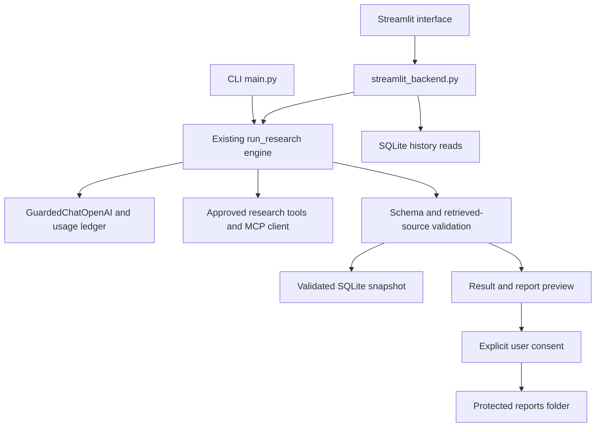

# AI Research Assistant

A local research assistant built with Python, LangChain, OpenAI, MCP search services, SQLite, and Streamlit. Ask a web or scientific question, receive a structured answer grounded in retrieved evidence, and optionally save or download the report.

**Deployment URL:** https://ai-research-llm4yemen.streamlit.app/ (restricted initial access).

Cloud research requires the approved durable Supabase budget configuration;
missing or unavailable budget storage blocks model requests. Cloud results are
session-scoped; shared SQLite history is disabled. See
[cloud setup](docs/community_cloud_deployment.md). Local operation is unchanged.

This is a local, single-operator capstone application, not an authenticated multi-user service. Final offline validation passed **201 automated tests**. Real historical CLI traces are included below; no new paid OpenAI calls were made for final validation. Public release remains subject to the licensing and historical-secret-review limitations in the attribution section.

## Features

- **Web Research:** Exa MCP by default, DuckDuckGo fallback, and Wikipedia support.
- **Scientific Research:** Semantic Scholar, OpenAlex, arXiv, and optional Ai2 Asta MCP.
- Structured `topic`, `summary`, `sources`, and `tools_used` output.
- Retrieved-reference validation, scientific paper deduplication, DOI/arXiv identity checks, and numbered citations.
- Persistent SQLite research snapshots with ID lookup, text search, UTC dates, and honest `degraded` status.
- Arabic/English Streamlit controls, clickable references, progress stages, history, consent-controlled report saving, and TXT downloads.
- Persistent spending reservations, measured token accounting, maximum-turn enforcement, and private JSONL traces.
- An explicit, isolated **DEMO** preview that makes no research requests.

Scientific answers use **available abstracts and metadata only**. Web answers use search snippets and Wikipedia extracts. The application does not read full papers, ingest PDFs, build embeddings, or implement vector RAG.

## Architecture



| Component | Purpose |
|---|---|
| `main.py` | Shared agent loop, structured validation, CLI, report formatting |
| `budget.py` | Fixed model configuration, reservations, caps, usage settlement, file locking |
| `tools.py` | Web research and protected report writing |
| `scientific_tools.py`, `research_models.py` | Academic adapters, abstracts, paper identity and stable source IDs |
| `mcp_client.py` | Bounded synchronous remote MCP client |
| `memory.py` | SQLite snapshots and bounded historical retrieval |
| `tracing.py`, `safety.py` | Allowlisted audit records, redaction and path/URL boundaries |
| `streamlit_backend.py` | Session-scoped adapter reusing the existing engine |
| `frontend/live.py`, `frontend/app.py` | Connected interface and separate demo presentation |
| `scripts/start_streamlit.py` | Secure local startup using process credentials or masked terminal input |

## Tools and MCP transport

| Agent-facing tool | Provider / operation |
|---|---|
| `exa_search` | Remote Exa MCP `web_search_advanced_exa`; anonymous search, five results and highlights |
| `duckduckgo_search` | Existing DuckDuckGo implementation; retained as fallback |
| `wikipedia_lookup` | Public Wikipedia extracts |
| `search_semantic_scholar` | Semantic Scholar metadata and abstracts |
| `search_openalex` | OpenAlex metadata and available abstracts |
| `search_arxiv` | arXiv metadata and abstracts |
| `search_asta` | Optional Ai2 Asta MCP `search_papers_by_relevance` |
| `save_report_to_disk` | Local protected writer; genuine human approval required |

The MCP implementation is a small **Streamable HTTP subset** using fixed HTTPS endpoints, JSON-RPC POST requests, and bounded JSON/SSE responses. It initializes the connection, sends the initialized notification, discovers tools, and invokes an allowlisted tool. It is not a local stdio server or a full MCP SDK. No Node or MCP SDK installation is required. Discovery checks the approved remote tool name; the client constructs fixed arguments rather than adopting server-provided tool descriptions as agent instructions.

Asta is not exposed to the agent unless `ASTA_TOOL_KEY` is configured. Semantic Scholar failure can recover through Asta when configured, then OpenAlex. Exa failure can try DuckDuckGo. A fallback does not guarantee that another provider will be available.

## Prerequisites and Windows setup

- Python **3.11+** is the intended baseline; the existing Windows environment was tested with **Python 3.14.7** and Streamlit **1.65.0**. Other Python/platform combinations were not validated in this final pass.
- OpenAI API access to the configured `gpt-6-luna` model for real research.
- Network access for real research providers. Viewing stored history does not require model access.

Use the existing `.venv` when available. Check it without downloading anything:

```powershell
.\.venv\Scripts\python.exe -I -m pip --isolated --disable-pip-version-check check
```

For a fresh checkout only, create an environment and install the pinned dependency files:

```powershell
py -3.14 -m venv .venv
.\.venv\Scripts\python.exe -m pip install -r requirements.txt -r requirements-ui.txt
```

Do not recreate or upgrade a working environment unnecessarily. pip can reuse its existing cache. If the project-local UI wheel cache is present, UI dependencies can be installed offline with:

```powershell
.\.venv\Scripts\python.exe -I -m pip --isolated --disable-pip-version-check install --no-index --find-links .runtime/ui_wheels -r requirements-ui.txt
```

That optional private cache is not part of a public checkout. No dependencies were installed or downloaded during final validation.

## Configuration and credentials

`.env.example` contains placeholders only. For **CLI configuration**, create a local file only if it does not already exist:

```powershell
if (-not (Test-Path -LiteralPath .env)) { Copy-Item -LiteralPath .env.example -Destination .env }
```

Fill placeholders privately on your own machine. Never paste credentials into questions, reports, screenshots, commits, or issue descriptions.

| Variable | Purpose |
|---|---|
| `OPENAI_API_KEY` | Required for real model requests |
| `SEMANTIC_SCHOLAR_API_KEY` | Optional academic credential |
| `OPENALEX_API_KEY` | Optional OpenAlex credential |
| `ASTA_TOOL_KEY` | Optional Asta MCP credential |
| `RESEARCH_MEMORY_DB` | Optional SQLite path inside `.runtime/` |

The CLI loads local `.env` configuration when a research task is started. Importing modules, showing help, checking spending, and memory-only commands do not load it.

**Streamlit deliberately does not load `.env`.** A CLI child process loading that file does not configure a separately started Streamlit process. The launcher below inherits existing process environment variables or asks for the OpenAI key through hidden terminal input. It passes the value in the child environment, not command arguments, files, output, or prompts. If hidden input is unavailable it fails closed rather than echoing the credential. Optional academic credentials must already be in the process environment.

Codex/ChatGPT sign-in is separate from the project's SDK credential. This application uses the OpenAI API endpoint and its own usage ledger; a Codex chat session is not proof of application API configuration. No claim is made that the exact same key value was used across sessions.

## CLI usage

Read recorded spending without a model request:

```powershell
.\.venv\Scripts\python.exe -B main.py --budget-status
```

The following are **real research commands and may spend API credit**:

```powershell
.\.venv\Scripts\python.exe -B main.py --mode web --query "What is MCP and how does it connect AI agents to tools?" --verbose
.\.venv\Scripts\python.exe -B main.py --mode scientific --query "What does research say about RAG in education?" --verbose
.\.venv\Scripts\python.exe -B main.py --mode web --query "How does arXiv work?" --save arxiv_report.txt
```

The last command previews the validated report and asks for approval. Answering `n` creates no report. Saving is restricted to `reports/`; unique timestamp/UUID filenames and exclusive creation prevent silent overwrites.

Use `--web-provider duckduckgo` only when intentionally selecting the existing alternate provider. Do not reset the ledger to work around a budget stop.

## Streamlit startup

From an interactive terminal in the project directory:

```powershell
.\.venv\Scripts\python.exe -B scripts/start_streamlit.py
```

Open **http://127.0.0.1:8502/**. The launcher may ask for a masked credential when the process has none. A boolean-only configuration check makes no server or model request:

```powershell
.\.venv\Scripts\python.exe -B scripts/start_streamlit.py --check
```

If the port is occupied, stop that server in its own terminal or choose another port:

```powershell
.\.venv\Scripts\python.exe -B scripts/start_streamlit.py --port 8503
```

When the environment is already configured, direct startup also works:

```powershell
.\.venv\Scripts\python.exe -B -m streamlit run streamlit_app.py --server.address 127.0.0.1 --server.port 8502
```

Restart the server after Python changes because file watching is disabled. A previously started server on 8501 may still show the old demo-only code; changing files alone does not restart it. Do not bind this unauthenticated application to a public network.

Research executes only on explicit submission. Tabs, language changes, history reads, saving, and downloading do not rerun it. Repeating a question requires a separate, single-use acknowledgment of possible new cost. Failed attempts are also remembered within the session, preventing automatic paid retries. Reloading the browser can lose temporary session state; reopen the SQLite result instead of repeating research.

The explicit DEMO switch retains labelled fixtures for UI review. Demo data never replaces a failed real answer or enters real research memory. Some engine messages remain in their original language when controls are switched.

## SQLite memory

Default: `.runtime/memory/research.sqlite3`. Configure a different approved private path using `--memory-db` or `RESEARCH_MEMORY_DB`. The path must remain inside `.runtime/` and use a supported SQLite extension.

```powershell
.\.venv\Scripts\python.exe -B main.py --memory-init
.\.venv\Scripts\python.exe -B main.py --memory-list --memory-limit 5
.\.venv\Scripts\python.exe -B main.py --memory-search "RAG" --memory-limit 5
.\.venv\Scripts\python.exe -B main.py --memory-get "REPLACE_WITH_A_REAL_TASK_ID"
```

Memory-only commands are offline. Validated `success` and `degraded` research is stored automatically with its question, topic, mode, summary, ordered references, tools, UTC date, and task ID. Failed/unvalidated answers are not stored as completed research. The same task cannot replace an existing snapshot. Storage failure is disclosed without hiding a valid answer.

Historical retrieval is labelled untrusted and not freshly verified. At most three small relevant snippets are available **to application context only; previous research is not supplied to the LLM**. Historical citations never populate a new task's evidence pool. Search is bounded text search, not semantic/vector memory. See [SQLite details](docs/sqlite_memory.md).

`owner_id` is a host-selected namespace, not authentication. The UI uses the local operator namespace; browsers with access to that local service share that operator's space. Secure multi-user isolation and database encryption are not implemented.

## Source verification and reports

Only retrieved evidence can support final references. Scientific tools assign stable IDs such as `P1`; the host resolves them to original retrieved URLs. Known DOI identities and unambiguous arXiv identities can resolve equivalent links without fetching a guessed reference. Explicitly different arXiv versions, unknown IDs, and records without usable abstracts are rejected.

Numbered scientific citations must match the ordered reference list. Every number in supported grouped citations such as `[1, 2]` is checked. Ambiguous numeric ranges are rejected. A shortage of evidence is disclosed; failed searches do not prove that no studies exist.

These checks establish reference provenance and numbering, **not independent verification of every claim, factual accuracy, or source relevance**. Two URLs may come from the same organization. The model may still misinterpret snippets or abstracts.

Streamlit downloads the displayed report in memory without a model request. Server-side saving requires a separate checkbox and save click, then uses the same protected writer as CLI. Automatic SQLite recording does not imply permission to save a report. Historical exports are labelled as previous research, not fresh retrieval.

## Spending and execution limits

| Control | Actual application setting |
|---|---:|
| Maximum estimated charge per research task | $0.03 |
| Daily cap, application accounting day | $0.30 |
| Cumulative experiment cap | $5.00 |
| Maximum model calls per task | 10 |
| Maximum output tokens per call | 1,200 |
| Conservative input estimate bound | 200,000 |

Before each model call the application reserves an estimated charge in `.runtime/usage.json`, with locking across processes. Measured usage settles the reservation. Failed/interrupted calls with uncertain billing keep their reservation; missing or corrupt prior state fails closed. Streamlit and CLI use this same ledger.

The input bound is a byte-based conservative estimate, not a measured token count. These are **application-side protections**, not provider-enforced account spending guarantees. Activity outside this application is not tracked. See the existing [cost analysis](cost_analysis.md); it was not regenerated during final validation.

## Automated validation

The complete suite is offline. Model HTTP responses and research services are mocked; real LangChain/SDK integration and SQLite/file operations execute against isolated fixtures.

```powershell
.\.venv\Scripts\python.exe -X utf8 -B -m unittest discover -s tests -q
.\.venv\Scripts\python.exe -X utf8 -B -m unittest discover -s tests -p test_final_security.py -v
.\.venv\Scripts\python.exe -I -m pip --isolated --disable-pip-version-check check
.\.venv\Scripts\python.exe -B scripts/verify_submission.py
```

Final result: **201 tests passed**. Controlled hostile cases cover exfiltration attempts, forged write approval, hostile stored memory, malicious direct inputs, citation manipulation, and overwrites. Deterministic host-boundary tests are not a live-model jailbreak-resistance evaluation. See [final validation report](docs/final_validation_report.md) and [attack scenarios](docs/security_test_cases.md).

Tests never reset the real budget ledger. Their synthetic ledgers/traces remain in `.runtime/tests/`, and report fixtures in `reports/.tests/`. AppTest's `missing ScriptRunContext` warnings are expected in test mode; assertive failure-case warnings are not failed test results.

## Submission traces

| File | Historical source run | Events | Final status |
|---|---|---:|---|
| [success_1.jsonl](traces/success_1.jsonl) | `46c433f92cc74827a77a5cddb3a26e6a` | 17 | `success` |
| [near_failure_recovery.jsonl](traces/near_failure_recovery.jsonl) | `d30d284e0f1341b18c34dea318dc1d8c` | 27 | `degraded` |
| [explicit_failure.jsonl](traces/explicit_failure.jsonl) | `70d4c78c3b6b44b693f687d892df45d1` | 20 | `no_evidence` |

These are complete, naturally occurring historical CLI runs, not manufactured or injected events. They demonstrate Exa-backed success, scientific provider failure and recovery, and safe failure when all attempted scientific services were rate-limited. They retain original task identity, chronology, usage, and outcome. No new paid call was needed to create the deliverables. The previous trivial invalid-input example is preserved in `traces/archive/`.

```powershell
.\.venv\Scripts\python.exe -B scripts/verify_submission.py
Get-Content traces/success_1.jsonl
Get-Content traces/near_failure_recovery.jsonl
Get-Content traces/explicit_failure.jsonl
```

The verifier checks identity, sequence, accounting, and required outcome/recovery evidence. Where private originals exist, it also checks full normalized run equality. Public clones cannot independently inspect private originals. Prompts, credentials, and final answer bodies are intentionally not part of the trace schema; validated final status is emitted only after output validation.

Private traces stay in `.runtime/traces/`. The existing exporter refuses to overwrite evidence or promote mocked/probe runs. Use it only for a completed suitable genuine CLI run:

```powershell
.\.venv\Scripts\python.exe -B scripts/export_trace.py .runtime/traces/REAL_TASK_ID.jsonl success_1
```

That example intentionally refuses while the target deliverable already exists. UI execution traces use `streamlit`; they are not relabelled as CLI runs.

## Known limitations and remaining work

- Scientific services can return 429, timeouts or unavailable responses. Asta live research remains unverified without its optional credential.
- Web output may exceed the fixed 1,200-token response allowance, causing invalid structured output. `finish_reason` is not currently captured, so past truncation is a supported hypothesis rather than a proven cause in every case.
- Citations are provenance-checked, not a full semantic fact-check. Academic abstracts may be missing or truncated, and full papers are not reviewed.
- SQLite memory is application-level history, not model memory, vector RAG, or cross-user authentication.
- This local application has no public deployment, authenticated access, retention policy, or hardened multi-user service. Do not expose it to the internet as-is.
- New paid Streamlit research and live-model hostile-input tests were not executed during final validation. They require explicit approval before an agent runs them.

## Attribution and licensing status

The project adapts the tutorial agent from [Tech With Tim — PythonAIAgentFromScratch](https://github.com/techwithtim/PythonAIAgentFromScratch). The tutorial's agent/tool-calling approach was extended incrementally; it was not replaced with another agent framework.

On **5 November 2026**, the reviewed upstream repository root and displayed README did **not show an explicit license grant**. This project does not assume MIT, Apache, or another license for upstream code and does not add a guessed license. Confirm the applicable permission/license with the rights holder before public redistribution. [GitHub's licensing guidance](https://docs.github.com/en/repositories/managing-your-repositorys-settings-and-features/customizing-your-repository/licensing-a-repository) explains why a public repository alone is not a general license grant.

`sample.env` was removed from the local Git index and ignored without reading or deleting its on-disk contents. That does not erase earlier commits. A historical credential review remains outstanding; no claim is made that unread environment files or repository history are secret-free. No history was rewritten and no commit or push was made by final validation.

Deployment, public release/licensing clearance, and any newly authorized paid validation remain separate steps.
